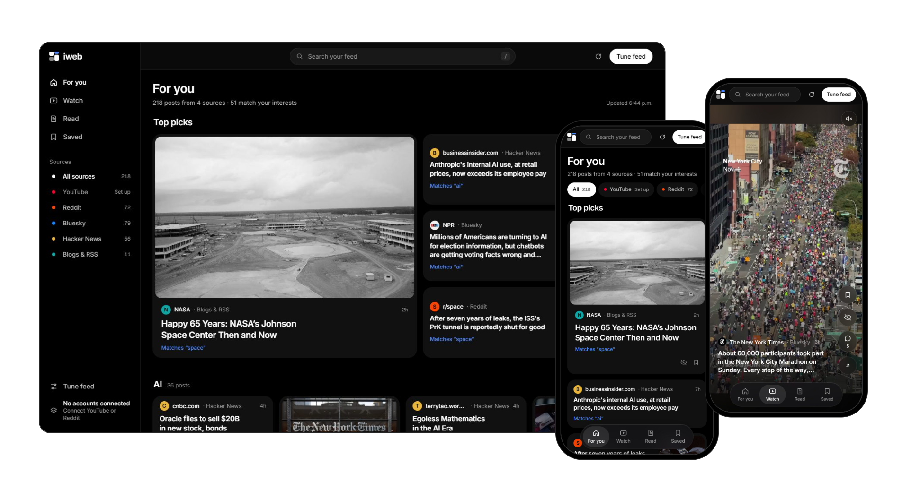
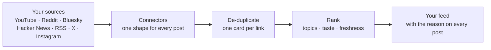

<p align="center">
  <picture>
    <source media="(prefers-color-scheme: dark)" srcset="docs/logo-dark.svg">
    
  </picture>
</p>

<h1 align="center">iweb</h1>

<p align="center">
  <strong>Your personal internet.</strong><br>
  One feed for everything you follow, ranked the way you choose.
</p>

<p align="center">
  <a href="https://github.com/4040chan/mewsnewws/actions/workflows/ci.yml"></a>
  <a href="LICENSE"></a>
  
  
</p>

<p align="center">
  <a href="#quick-start">Quick start</a> ·
  <a href="#where-the-posts-come-from">Sources</a> ·
  <a href="#run-it-on-a-server">Self-hosting</a> ·
  <a href="#configuration">Configuration</a> ·
  <a href="CONTRIBUTING.md">Contributing</a>
</p>

<br>

<p align="center">
  
</p>

<br>

YouTube, Reddit, Bluesky, Hacker News, blogs and news sites all land on one board. iweb ranks them together, shows you why each post is there, and learns from what you save and hide. It runs on your own computer or server, so your accounts and your taste never leave it.

<table>
  <tr>
    <td width="50%" valign="top">
      <h3>One board, every platform</h3>
      Pictures first, in a calm masonry layout. Every post is marked with where it came from, and the same link shared in three places becomes one card.
    </td>
    <td width="50%" valign="top">
      <h3>A feed with an ending</h3>
      Top picks come first, then a chapter for each of your interests, then everything else, and finally "You're caught up."
    </td>
  </tr>
  <tr>
    <td width="50%" valign="top">
      <h3>You set the algorithm</h3>
      Pick your topics, turn each source up or down, and read the reason on every card: "Matches 'space'", "Trending", "From your Reddit home feed".
    </td>
    <td width="50%" valign="top">
      <h3>Learns quietly</h3>
      Saving a post shows you more like it; "Less like this" shows less. You can see what it has learned and reset it any time.
    </td>
  </tr>
  <tr>
    <td width="50%" valign="top">
      <h3>Watch, Read, Saved</h3>
      Watch turns every video into full-screen reels. Read keeps only articles and text. Saved holds what you liked.
    </td>
    <td width="50%" valign="top">
      <h3>Yours to run</h3>
      Plain Node and vanilla JavaScript, no build step and no dependencies. One command on your laptop, or one container on a server.
    </td>
  </tr>
</table>

## How it works



Each platform is one small file in [`connectors/`](connectors), using official APIs and public feeds only: no scraping, and no pretending to be a browser.

## Quick start

You need [Node.js 22 or newer](https://nodejs.org).

```bash
git clone https://github.com/4040chan/mewsnewws.git iweb
```

```bash
cd iweb && npm start
```

Open **http://localhost:3000**. Bluesky, Hacker News, Reddit's public feeds and RSS work straight away with no keys. Click **Tune feed** to pick your topics and sources.

Prefer Docker? Your data is kept in a volume:

```bash
docker compose up -d
```

To connect your YouTube or Reddit account, or to add X and Instagram, copy `.env.example` to `.env`, fill in the keys you want, and restart. Each key is explained in that file.

## Where the posts come from

| Source | What it pulls | Setup |
|---|---|---|
| **Bluesky** | Everyone your handle follows, plus any accounts you list | None |
| **Hacker News** | The front page, plus stories that match your interests | None |
| **Blogs & RSS** | Any RSS or Atom feed: news, Substack, Mastodon (`@user.rss`), podcasts | None |
| **Reddit** | Your home feed and any subreddits you list | None for public feeds (rate-limited). Sign in for your home feed |
| **YouTube** | Your subscriptions, channels you list, and discovery by interest | Sign in with Google, or a free API key for listed channels |
| **X** | Recent posts from accounts you list | A **paid** X API plan |
| **Instagram** | Recent posts from public Business and Creator accounts | A Meta developer app. Instagram has no API for a personal feed |

<details>
<summary><strong>Signing in with Google and Reddit</strong></summary>
<br>

**Tune feed → Your accounts** has "Sign in with Google" (imports your YouTube subscriptions) and "Sign in with Reddit" (imports your home feed). Each needs a free developer app that you set up once; the settings panel walks you through it and shows the exact redirect address to register.

- **Google:** in [Google Cloud Console](https://console.cloud.google.com/apis/credentials), enable *YouTube Data API v3* and create an OAuth client ID of type *Web application* with the redirect URI `<your address>/auth/youtube/callback`. Add yourself as a test user, then put `GOOGLE_CLIENT_ID` and `GOOGLE_CLIENT_SECRET` in `.env`. While the Google app is in Testing mode, Google ends the sign-in after 7 days, so you reconnect weekly.
- **Reddit:** at [reddit.com/prefs/apps](https://www.reddit.com/prefs/apps), create a *web app* with the redirect URI `<your address>/auth/reddit/callback`, then put `REDDIT_CLIENT_ID` and `REDDIT_CLIENT_SECRET` in `.env`.

Sign-in uses the standard OAuth authorization-code flow with a CSRF check and asks for read access only. Tokens stay in the data folder on your machine and are never sent to the browser. **Disconnect** deletes and revokes them.

</details>

## Run it on a server

iweb is built for one person, or a household sharing one feed. Put it on a small server to reach it from your phone and laptop anywhere.

1. **Set a password.** With `IWEB_PASSWORD` set, every page needs it, and a sign-in lasts 30 days on each device. Without it, anyone who finds the address can read your feed and change your settings, and iweb warns you at startup.
2. **Set `BASE_URL`** to the address you'll use, such as `https://feed.example.com`. Register the matching sign-in redirect addresses with Google and Reddit.
3. **Serve it over HTTPS.** Most hosts handle this; on your own server, put Caddy or nginx in front.
4. **Keep the data folder.** Settings, saved posts and sign-in tokens live in `DATA_DIR` (`/data` in the Docker image), so mount a volume there.

<a href="https://render.com/deploy?repo=https://github.com/4040chan/mewsnewws"></a>

The [Render Blueprint](render.yaml) asks for your password and keys and adds a 1 GB disk for your data (disks need a paid instance). Anywhere else that runs Docker, such as Fly.io, Railway, a VPS or a home server:

```bash
docker build -t iweb .
```

```bash
docker run -d -p 3000:3000 -v iweb-data:/data -e IWEB_PASSWORD=choose-one -e BASE_URL=https://feed.example.com iweb
```

Without Docker, install Node 22+, clone the repo and run `npm start` under a process manager such as systemd.

**Want a public demo?** `DEMO=1` (or `npm run demo`) turns an install into a read-only showcase with no sign-in. Each visitor's topics, saves and hides stay in their own browser, and nothing they do reaches the server.

## Configuration

Everything goes in `.env` or the environment, and everything is optional.

<details>
<summary><strong>All settings</strong></summary>
<br>

| Variable | What it does |
|---|---|
| `PORT` | Port to listen on (default `3000`) |
| `BASE_URL` | The address you open iweb at, used for sign-in redirects |
| `IWEB_PASSWORD` | Locks the whole site behind one password |
| `DATA_DIR` | Where settings, saved posts and tokens are stored (default `./data`) |
| `DEMO` | `1` for a public read-only demo |
| `SOURCE_URL` | The "Source code" link shown in the app. Point it at your fork if you change the code |
| `ALLOW_PRIVATE_FEEDS` | `1` to allow feed URLs on your own network. They're refused by default so a public install can't be used to probe its host's network |
| `GOOGLE_CLIENT_ID`, `GOOGLE_CLIENT_SECRET` | Sign in with Google (YouTube subscriptions) |
| `YOUTUBE_API_KEY` | YouTube for listed channels without signing in |
| `REDDIT_CLIENT_ID`, `REDDIT_CLIENT_SECRET` | Sign in with Reddit, and higher limits without signing in |
| `X_BEARER_TOKEN` | X posts (paid X API plan) |
| `IG_ACCESS_TOKEN`, `IG_USER_ID`, `IG_GRAPH_VERSION` | Instagram Business and Creator accounts |

</details>

<details>
<summary><strong>How the ranking works</strong></summary>
<br>

Each post's score combines these parts (see [`lib/ranker.js`](lib/ranker.js)):

- **Interests.** Posts that mention your topics are boosted, and Hacker News and YouTube also search for them.
- **Learned taste.** Saving a post and choosing "Less like this" adjust the weights of words and authors.
- **Popularity, per platform.** Each post is compared with its own source's top 10%, so a million YouTube views and 300 Hacker News points land on a comparable scale.
- **Freshness.** Older posts fade out. Slow sources such as YouTube and blogs fade more slowly, so Reddit's churn doesn't bury them.
- **Your source weights.** A slider for each source sets "less ↔ more of this".
- **Balance.** Busy sources get a volume correction, and a final pass stops any one source or author from taking over a stretch of the feed.

</details>

<details>
<summary><strong>Project layout</strong></summary>
<br>

```
server.js            HTTP server and JSON API (no framework)
connectors/*.js      one file per platform, each turning its posts into one common shape
lib/ranker.js        scoring, diversity, learning from feedback
lib/dedupe.js        merging the same link across platforms
lib/profile.js       your settings and learned taste
lib/accounts.js      Sign in with Google / Reddit
lib/gate.js          the optional password
lib/guard.js         safe fetching of user-supplied feed URLs
public/              the web app (vanilla JS and CSS)
test/                node:test suites, run with npm test
```

</details>

## Contributing

New connectors, fixes and ideas are welcome. [CONTRIBUTING.md](CONTRIBUTING.md) covers running the tests and writing a connector for a new platform. Please report security issues privately, as described in [SECURITY.md](SECURITY.md).

## License

iweb is free software under the [GNU Affero General Public License v3.0](LICENSE) or later.

You can use, study, change and share it, including commercially. If you run a changed version that other people use over a network, offer them its source code under the same license; the **Source code** link at the bottom of Tune feed does this once you point `SOURCE_URL` at your fork. Running it unmodified, or keeping your changes for your own use, asks nothing of you.
