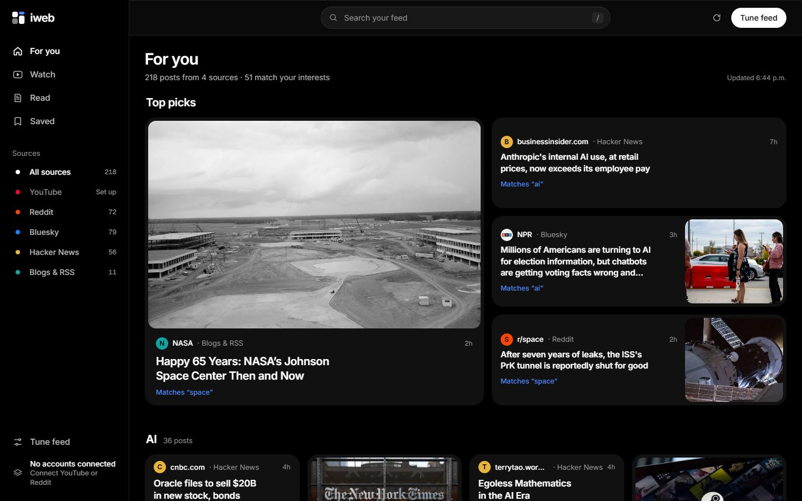
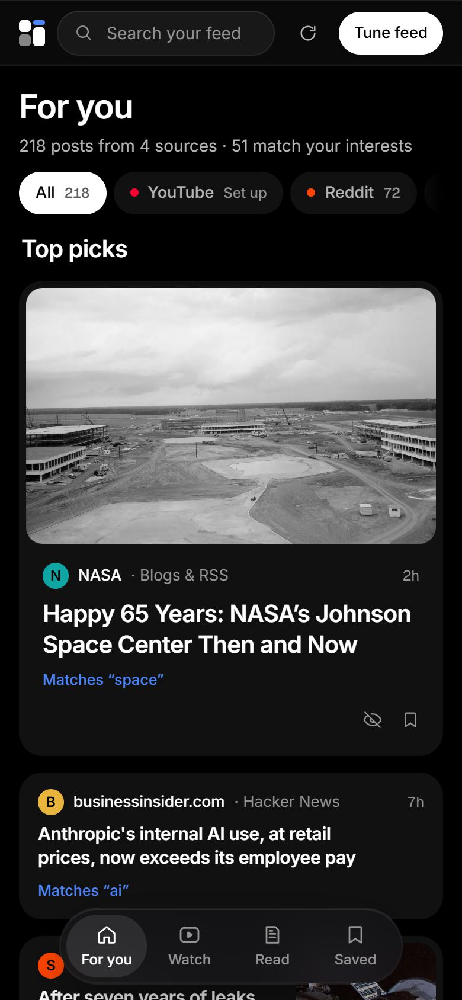

# iweb: your personal internet

One feed built from the places you already follow: YouTube, Reddit, Bluesky, Hacker News, blogs and news sites, Mastodon, and (with your own API keys) X and Instagram. iweb ranks it all together, tells you why each post is there, and learns from what you save and hide. It runs on your own computer or server; your accounts and taste never leave it.



<p align="center">
  
  &nbsp;&nbsp;
  
</p>

- **One board, every platform.** Pictures first, in a masonry layout, with each post marked with where it came from.
- **A feed you can read to the end.** For you opens with Top picks, then a chapter per interest ("AI", "Space"), then everything else, and finally "You're caught up".
- **You control the algorithm.** Pick your topics, weight each source, and see the reason on every card ("Matches 'space'", "Trending", "From your Reddit home feed").
- **Watch** turns every video into full-screen reels. **Read** shows only articles and text. **Saved** keeps what you liked.
- **Duplicates merge.** A link posted to Reddit, Hacker News and a blog becomes one card with "Also on r/space · 340 comments".
- **No build step and no dependencies.** It's plain Node and vanilla JavaScript.

## Quick start

You need [Node.js 22 or newer](https://nodejs.org).

```bash
git clone https://github.com/4040chan/mewsnewws.git iweb
```

```bash
cd iweb && npm start
```

Open http://localhost:3000. Bluesky, Hacker News, Reddit (public feeds) and RSS work straight away with no keys. Click **Tune feed** to set your topics and sources.

To connect YouTube or Reddit accounts, or to add X and Instagram, copy `.env.example` to `.env`, fill in the keys you want, and restart. Each key is explained in that file.

**With Docker** (your data is kept in a volume):

```bash
docker compose up -d
```

## Where the posts come from

| Source | What it pulls | What it needs |
|---|---|---|
| Bluesky | Everyone your handle follows, plus any accounts you list | Nothing (public API) |
| Hacker News | Front page, plus stories matching your interests | Nothing |
| Blogs & RSS | Any RSS/Atom feed: news, Substack, Mastodon (`@user.rss`), podcasts | Nothing |
| Reddit | Your home feed (signed in), plus any subreddits you list | Works without keys through public RSS, which Reddit rate-limits. Sign in with Reddit for your home feed and higher limits |
| YouTube | Your subscriptions (signed in), channels you list, and discovery by interest | Sign in with Google, or a `YOUTUBE_API_KEY` for listed channels only |
| X | Recent posts from accounts you list | `X_BEARER_TOKEN`, which needs a **paid** X API plan |
| Instagram | Recent posts from public Business/Creator accounts | A Meta developer app and an Instagram professional account. Instagram has no API for a personal home feed |

iweb only uses each platform's official API or public feeds. It doesn't scrape pages or pretend to be a browser.

## Sign in with your accounts

**Tune feed → Your accounts** has "Sign in with Google" (imports your YouTube subscriptions) and "Sign in with Reddit" (imports your Reddit home feed). Each needs a free developer app that you set up once. The settings panel walks you through it and shows the exact redirect URI to register.

- **Google:** in [Google Cloud Console](https://console.cloud.google.com/apis/credentials), enable *YouTube Data API v3* and create an OAuth client ID of type *Web application* with the redirect URI `<your address>/auth/youtube/callback`. Add yourself as a test user, then put `GOOGLE_CLIENT_ID` and `GOOGLE_CLIENT_SECRET` in `.env`. While the Google app is in Testing mode, Google ends the sign-in after 7 days, so you reconnect weekly.
- **Reddit:** at [reddit.com/prefs/apps](https://www.reddit.com/prefs/apps), create a *web app* with the redirect URI `<your address>/auth/reddit/callback`, then put `REDDIT_CLIENT_ID` and `REDDIT_CLIENT_SECRET` in `.env`.

Sign-in uses the standard OAuth authorization-code flow with a CSRF check, and asks only for read access. Tokens are stored in the data folder and never sent to the browser. **Disconnect** deletes and revokes them.

## Running it on a server

iweb is built for one person, or a household sharing one feed. To reach it from your phone and laptop anywhere, run it on a small server.

1. **Set a password.** With `IWEB_PASSWORD` set, every page and API call needs that password, and a sign-in lasts 30 days on each device. Without it, anyone who finds the address can read your feed and change your settings and accounts. iweb prints a warning if you forget.
2. **Set `BASE_URL`** to the address you'll use, for example `https://feed.example.com`. Sign-in redirect URIs are built from it, so register those exact URLs with Google and Reddit.
3. **Serve it over HTTPS.** Most hosts do this for you. On your own server, put it behind Caddy or nginx.
4. **Keep the data folder.** Settings, saved posts and sign-in tokens live in `DATA_DIR` (default `./data`). The Docker image uses `/data`; mount a volume there.

**Render:** this repo includes a [Render Blueprint](render.yaml). [](https://render.com/deploy?repo=https://github.com/4040chan/mewsnewws) It asks for your password and keys, and adds a 1 GB disk for your data. Disks need a paid instance.

**Anywhere that runs Docker** (Fly.io, Railway, a VPS, a home server):

```bash
docker build -t iweb .
```

```bash
docker run -d -p 3000:3000 -v iweb-data:/data -e IWEB_PASSWORD=choose-one -e BASE_URL=https://feed.example.com iweb
```

**Without Docker:** install Node 22+ on the server, clone the repo, and run `npm start` under a process manager such as systemd.

### A public demo

`DEMO=1` (or `npm run demo`) turns an install into a public, read-only demo. Visitors see a feed from your configured public sources, with no sign-in. Their topics, saves and hides stay in their own browser. Nothing a visitor does reaches the server, so they can't change its sources or accounts.

## Configuration

Every setting goes in `.env` or the environment. All of them are optional.

| Variable | What it does |
|---|---|
| `PORT` | Port to listen on (default `3000`) |
| `BASE_URL` | The address you open iweb at, used for sign-in redirects |
| `IWEB_PASSWORD` | Locks the whole site behind one password |
| `DATA_DIR` | Where settings, saved posts and tokens are stored (default `./data`) |
| `DEMO` | `1` for a public read-only demo |
| `SOURCE_URL` | The "Source code" link shown in the app. Point it at your fork if you change the code |
| `ALLOW_PRIVATE_FEEDS` | `1` to allow feed URLs on your own network. These are refused by default so a public install can't be used to probe its host's network |
| `GOOGLE_CLIENT_ID`, `GOOGLE_CLIENT_SECRET` | Sign in with Google (YouTube subscriptions) |
| `YOUTUBE_API_KEY` | YouTube for listed channels without signing in |
| `REDDIT_CLIENT_ID`, `REDDIT_CLIENT_SECRET` | Sign in with Reddit, and higher limits without signing in |
| `X_BEARER_TOKEN` | X posts (paid X API plan) |
| `IG_ACCESS_TOKEN`, `IG_USER_ID`, `IG_GRAPH_VERSION` | Instagram Business/Creator accounts |

## How the feed is ranked

Each post's score combines these parts (see [`lib/ranker.js`](lib/ranker.js)):

- **Interests.** Posts that mention your topics are boosted, and Hacker News and YouTube also search for them.
- **Learned taste.** Saving a post and choosing "Less like this" adjust the weights of words and authors. Tune feed shows what iweb has learned, and you can reset it.
- **Popularity, measured per platform.** Each post is compared with its own source's top 10%, so a million YouTube views and 300 Hacker News points are on a comparable scale.
- **Freshness.** Older posts fade out. Slow sources such as YouTube and blogs fade more slowly, so Reddit's constant churn doesn't bury them.
- **Your source weights.** A slider for each source sets "less ↔ more of this".
- **Balance.** Sources with lots of posts get a volume correction, and a final pass stops any one source or author from dominating a stretch of the feed.

## Project layout

```
server.js            HTTP server and JSON API (no framework)
connectors/*.js      one file per platform, each turning its posts into one common shape
lib/ranker.js        scoring, diversity, learning from feedback
lib/dedupe.js        merging the same link across platforms
lib/profile.js       your settings and learned taste
lib/accounts.js      Sign in with Google / Reddit
lib/gate.js          the optional password
lib/guard.js         safe fetching of user-supplied feed URLs
public/              the web app (vanilla JS and CSS)
test/                node:test suites, run with npm test
```

## Contributing

Bug reports, new connectors and fixes are welcome. Read [CONTRIBUTING.md](CONTRIBUTING.md) first: it explains how to run the tests and how to write a connector for a new platform. Report security issues privately, as described in [SECURITY.md](SECURITY.md).

## License

iweb is free software under the [GNU Affero General Public License v3.0](LICENSE) or later.

In plain terms: you can use, study, change and share iweb, including for commercial purposes. If you change it and let other people use your changed version over a network, you must offer them its source code under the same license. The **Source code** link at the bottom of Tune feed does this; set `SOURCE_URL` to your fork. Running it unmodified, or keeping your changes on your own server for your own use, asks nothing of you.

Copyright © 2026 the iweb contributors.
